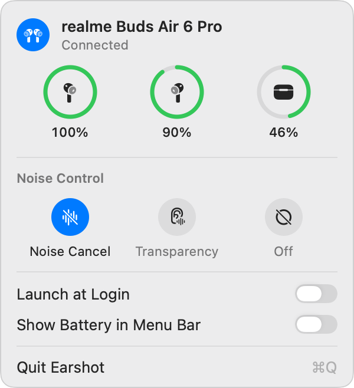
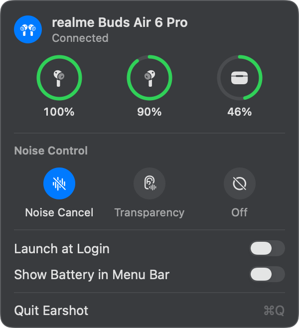

<p align="center">
  
</p>

<h1 align="center">Earshot</h1>

<p align="center">
  <b>Your realme buds, right in the menu bar.</b><br>
  Battery for each bud and the case, and one-click noise control, natively on macOS.
</p>

<p align="center">
  <a href="https://github.com/nk1044/earshot/releases/latest/download/Earshot.dmg"><b>Download Earshot.dmg</b></a> ·
  <a href="https://nk1044.github.io/earshot/">Website</a> ·
  <a href="app/PROTOCOL.md">Protocol notes</a>
</p>

<p align="center">
  <a href="https://github.com/nk1044/earshot/actions/workflows/ci.yml"></a>
  <a href="https://github.com/nk1044/earshot/releases/latest"></a>
  
  
</p>

<p align="center">
  
  &nbsp;&nbsp;
  
</p>

---

Earshot is a small native menu bar app for the **realme Buds Air 6 Pro**. It stays out of the way: the icon only appears while your buds are connected to the Mac, and it disappears when they leave.

## Features

- **Battery at a glance.** Left, right and case, as rings that are green, orange at 20 % or below, and red at 10 % or below, with a bolt while charging. Earshot never guesses a value: a bud the buds aren't reporting shows "—". The case keeps its last reported level, since the buds stop reporting it whenever the lid is closed.
- **Noise control in one click.** Noise Cancellation, Transparency or Off. The selection slides over and settles only once the buds confirm. If the buds refuse (ANC needs both buds in, the other modes need at least one), it springs back and tells you why. Long-press changes made on the buds show up too.
- **Optional battery ring in the menu bar.** It shows the lower bud's level as a ring around the icon.
- **Feels native.** The panel drops down like the system's Battery and Wi-Fi panels, follows Light and Dark Mode, works with VoiceOver, and respects Reduce Motion.
- **Featherweight.** 0.0 % CPU when idle and about 13 MB of memory while connected. No polling, no timers and no scanning. Launches at login (you can turn that off).

## Install

1. [Download **Earshot.dmg**](https://github.com/nk1044/earshot/releases/latest/download/Earshot.dmg), open it, and drag **Earshot** to **Applications**.
2. Open Earshot. Because it's free and not notarized by Apple, macOS asks first: click **Done**, then go to **System Settings › Privacy & Security** and click **Open Anyway**. In Terminal, this does the same:
   ```sh
   xattr -dr com.apple.quarantine /Applications/Earshot.app
   ```
3. Allow Bluetooth when asked, then connect your buds to the Mac. The icon appears in the menu bar.

**Requirements:** macOS 14 or later, on Apple silicon or Intel, with realme Buds Air 6 Pro paired and connected to the Mac.

Every release is built from this repository by GitHub Actions ([release workflow](.github/workflows/release.yml)). Each release also ships a SHA-256 checksum.

## Supported devices

| Model | Status |
|---|---|
| realme Buds Air 6 Pro | ✅ Tested on hardware (firmware 1.1.0.75) |
| Other realme / OPPO / OnePlus buds | Same protocol family. Each needs a profile; see [Adding another model](#adding-another-model). |

## Build from source

You need the Xcode Command Line Tools (Swift 6); full Xcode isn't required. The app has no third-party dependencies.

```sh
git clone https://github.com/nk1044/earshot.git
cd earshot/app
./scripts/setup-signing.sh      # once: a local code-signing identity
./scripts/build.sh --install    # build, sign, copy to /Applications and launch
swift test                      # unit tests
```

**Why a signing identity?** macOS ties the Bluetooth permission to the app's signature. An ad-hoc signature changes on every build, so macOS would ask again after each rebuild. `setup-signing.sh` creates a self-signed certificate in its own keychain (`~/Library/Keychains/earshot-signing.keychain-db`, with a random password in `~/.config/earshot/`). It doesn't touch your login keychain, your trust settings or your keychain search list. To remove it:

```sh
security delete-keychain ~/Library/Keychains/earshot-signing.keychain-db && rm -r ~/.config/earshot
```

`build.sh` also understands `UNIVERSAL=1` (Apple silicon and Intel), `VERSION=` and `BUILD_NUMBER=`. `scripts/make-dmg.sh` packages `build/Earshot.app` into `dist/Earshot.dmg`.

## Repository layout

```
app/                    the macOS app (Swift package)
  Sources/
    BudsProtocol/       frame codec, commands, reply/push parsers (no Apple frameworks)
    BudsCore/           device profiles, Transport protocol, BudsSession actor, DeviceStore
    BudsBluetooth/      IOBluetooth RFCOMM transport, connection lifecycle, channel lock
    EarshotApp/         status item, panel window and SwiftUI views (no Bluetooth logic)
    earshot-probe/      command-line protocol probe
  Tests/                protocol tests with frames captured from real buds; store and UI tests
  Packaging/            Info.plist and app icon
  scripts/              build, sign, DMG, icon and probe scripts
  PROTOCOL.md           the control protocol, with sources and hardware confirmation
website/                the project website (static HTML/CSS/JS, deployed to GitHub Pages)
.github/workflows/      CI, release (DMG) and website deployment
```

## How it works

realme, OPPO and OnePlus buds share a control protocol over classic Bluetooth RFCOMM, the one their phone apps speak. Earshot implements it independently. [PROTOCOL.md](app/PROTOCOL.md) documents every fact used, where it came from, and what has been confirmed on real hardware.

**Lifecycle.** At login Earshot is dormant: it holds only an IOBluetooth connect notification, and runs one check for buds that are already connected. When matching buds connect for audio, Earshot does four things:
1. Shows its menu bar item.
2. Waits a few seconds for macOS to finish setting up audio.
3. Opens the control channel and reads battery, wear and noise state once.
4. Arms a disconnect notification.

From then on, every update is a push from the buds; nothing polls. On disconnect it closes the panel, releases everything, removes the item, and goes back to dormant. It never connects to buds on its own and never scans.

**Architecture.** The protocol layer is pure Swift and unit-tested against frames captured from real buds. `BudsSession` is an actor that keeps one request in flight, with a 2.5 s timeout. `DeviceStore` is the observable UI state. The app layer is AppKit for the status item and panel placement, with SwiftUI for the panel's content. The panel's view tree exists only while it's open.

## Adding another model

Each model is one file in [`app/Sources/BudsCore/Profiles/`](app/Sources/BudsCore/Profiles). Copy `RealmeBudsAir6Pro.swift`, adjust it, and add the new type to `DeviceRegistry.all`:

```swift
public struct RealmeBudsAir7: DeviceProfile {
    public init() {}
    public let id = "realme-buds-air-7"
    public let displayName = "realme Buds Air 7"
    public let namePrefixes = ["realme Buds Air7"]          // spaces and case are ignored
    public let productIDs = ["064812"]                        // from `earshot-probe info`
    public let identifyingService: ServiceUUID? = .opoVendor
    public let controlServices: [ServiceUUID] = [.opoVendor, .serialPort]
    public let noiseModes: [NoiseMode] = [.noiseCancellation, .transparency, .off]

    public func noiseValue(for mode: NoiseMode) -> UInt8 { … }   // byte sent with command 0x0404
    public func noiseMode(fromValue value: UInt8) -> NoiseMode? { … }
}
```

Find the values with the probe rather than guessing. Then add the captured frames as tests next to [`CapturedFramesTests.swift`](app/Tests/BudsProtocolTests/CapturedFramesTests.swift).

## The probe

`earshot-probe` talks to your buds from Terminal and prints every frame in and out. Quit Earshot first: only one process can hold the buds' control channel, and the probe tells you if Earshot has it.

```sh
cd app
swift build -c release --product earshot-probe
.build/release/earshot-probe list                 # paired devices, SDP services, RFCOMM channels
.build/release/earshot-probe info                 # product id, firmware, wear, battery, noise
.build/release/earshot-probe noise set anc        # off | transparency | anc | 0xNN
.build/release/earshot-probe monitor 30           # print pushes (long-press a bud)
./scripts/probe-session.sh                        # guided run, saved to probe-output.txt
```

The probe never opens the buds' firmware-update channel.

## Performance

Measured on Apple silicon, macOS 27, with the release build. Memory is the physical footprint from `footprint`, which matches Activity Monitor.

| State | Memory | CPU | Idle wakeups |
|---|---|---|---|
| Connected and idle | 13 MB | 0.0 % | ≈ 0.2 / s |
| Dormant (buds away) | ≤ 15 MB | 0.0 % | 0 |

To check it on your own Mac:

```sh
footprint $(pgrep -x Earshot) | grep phys_footprint
top -l 6 -s 5 -pid $(pgrep -x Earshot) -stats pid,cpu,mem,threads,idlew,power
```

## Releasing

```sh
git tag v1.1.0 && git push origin v1.1.0
```

The [release workflow](.github/workflows/release.yml) runs the tests and builds a universal app stamped with the version. It then packages `Earshot.dmg` and publishes a GitHub Release. The website's download button always points at the latest release. Changes under `website/` deploy to GitHub Pages automatically.

## Troubleshooting

| Symptom | Fix |
|---|---|
| No icon after connecting the buds | Make sure Earshot is running (`pgrep -l Earshot`) and allowed under **System Settings › Privacy & Security › Bluetooth**. The buds must be connected **to this Mac** for audio. |
| "Couldn't reach the buds" | Click **Try Again**. Earshot restarts itself to reset macOS's Bluetooth session, which is the only fix when macOS gets stuck. |
| "earshot-probe is using the buds" | Quit the probe, or any other app talking to the buds, then click **Try Again**. |
| Noise control springs back | The buds refuse mode changes unless they're worn: ANC needs both buds, the other modes need one. |
| macOS asks for Bluetooth after every build | Run `scripts/setup-signing.sh` once, then rebuild. |
| "Launch at Login" won't stay on | Approve Earshot under **System Settings › General › Login Items**. |

**Logs.** Earshot logs under the subsystem `io.github.nk1044.earshot`. Hex frame logging is built in but off by default:

```sh
defaults write io.github.nk1044.earshot LogFrames -bool YES     # then reconnect the buds
log stream --level debug --predicate 'subsystem == "io.github.nk1044.earshot"'
```

## Credits

Protocol facts were learned from these open-source projects and re-implemented independently. No code was copied.
- [Gadgetbridge](https://codeberg.org/Freeyourgadget/Gadgetbridge), for its realme Buds Air 6 Pro support.
- [OneBuds](https://github.com/himanshudev28/OneBuds)
- [realme-buds-mac](https://github.com/kalki-kgp/realme-buds-mac)

Details are in [PROTOCOL.md](app/PROTOCOL.md).

---

Earshot is an independent project, not affiliated with or endorsed by realme, OPPO or Apple. realme is a trademark of its owner. AirPods, Mac and macOS are trademarks of Apple Inc.
